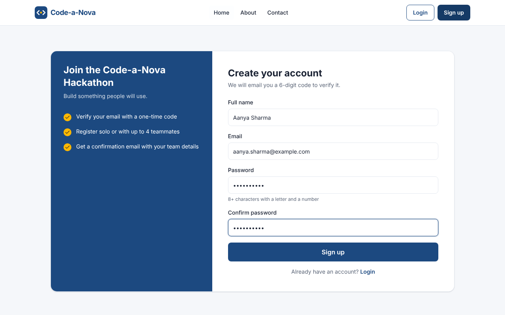
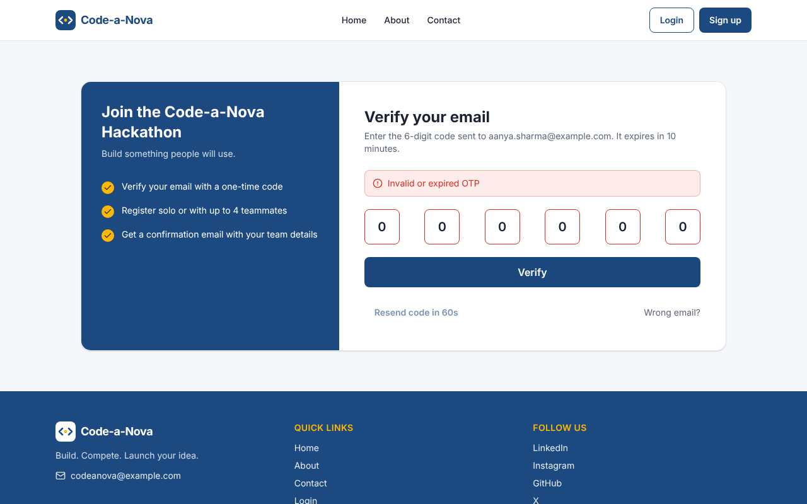
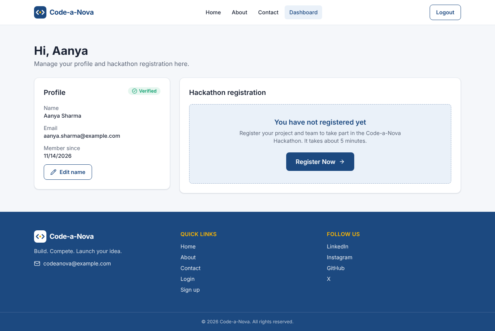
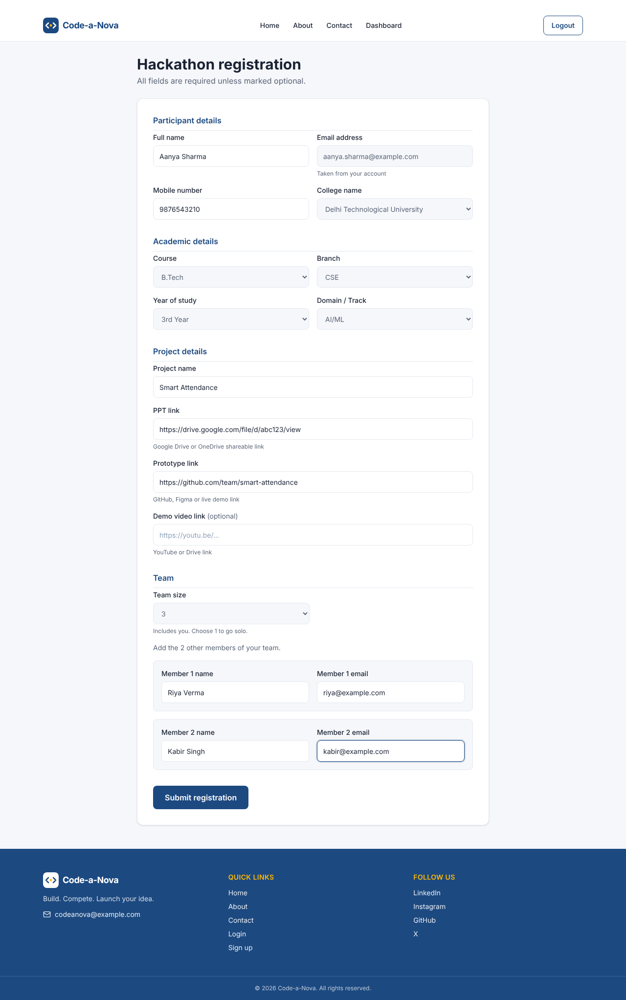
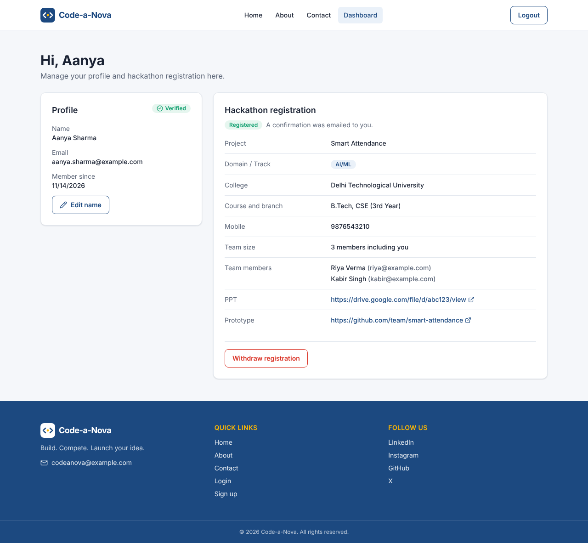
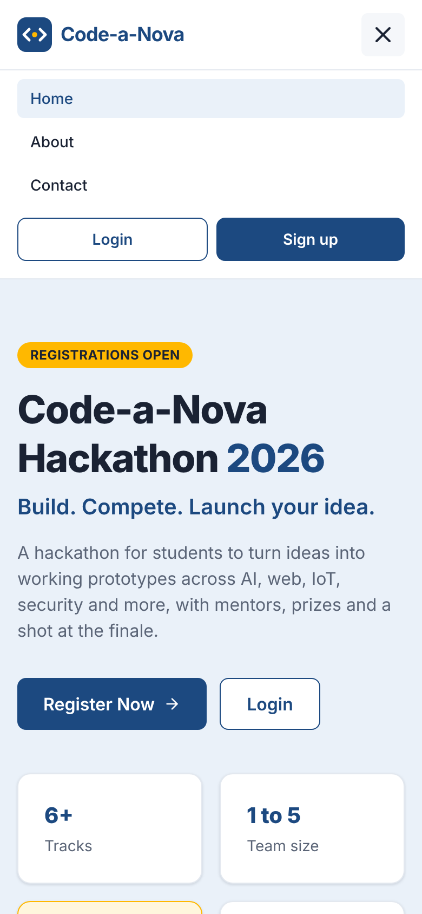

# Code-a-Nova Hackathon Registration Portal

A full-stack registration portal for the Code-a-Nova Hackathon. Students can create an account, verify their email, log in, and submit their project and team details. The application is built with the MERN stack using TypeScript across the frontend and backend, and is deployed on Render.

|  |  |
| --- | --- |
| **Live app** | `https://code-a-nova-web.onrender.com/` |
| **API documentation** | `https://code-a-nova-web.onrender.com/api/docs` |

## Features

1. **Account creation:** Students can sign up using their name, email and password. A six-digit verification code is sent to their email.
2. **Email verification:** The code expires after 10 minutes and can only be used once. The verification screen supports typing, pasting and autofill. After five incorrect attempts, a new code is required.
3. **Login:** Verified users can log in and access their dashboard.
4. **Dashboard:** Users can view and update their profile, check their registration details, and withdraw their registration.
5. **Hackathon registration:** Students can submit their college, course, branch, track, project name, PPT, prototype and demo links, along with their team details. The number of member fields changes based on the selected team size.
6. **Confirmation email:** After registration, an email containing the event and team details is sent to the user.

The portal also includes a home page with event highlights, timeline and prizes, along with About and Contact pages. The navigation menu works on both desktop and mobile screens.

## Screenshots

| Home | Sign up |
|---|---|
|  |  |

| OTP verification | Dashboard (not registered) |
|---|---|
|  |  |

| Registration form | Registration success |
|---|---|
|  |  |

| Registered dashboard | Mobile menu |
|---|---|
|  |  |

## Tech Stack

| Layer | Technology | Purpose |
| --- | --- | --- |
| Frontend | React 19, Vite, TypeScript, React Router | Building the web application and handling navigation |
| Styling | Tailwind CSS v4 | Styling and responsive layouts |
| Forms | React Hook Form, Zod | Form handling and validation |
| Backend | Node.js, Express, TypeScript | API and application logic |
| Database | MongoDB Atlas, Mongoose | Storing user, registration and contact data |
| Authentication | JWT, bcrypt | User authentication and password hashing |
| Email | Nodemailer, SMTP | OTP verification and registration emails |
| API documentation | OpenAPI 3, Swagger UI | API specification and request validation |
| Backend testing | Jest, Supertest | API and service tests |
| Frontend testing | Vitest, Testing Library | Component and form tests |
| Hosting | Render | Hosting the API and frontend |

## Implementation Details

### API and validation

The API specification is maintained in `server/openapi/openapi.yaml`. It is used for request validation, Swagger documentation and generating TypeScript types for both the frontend and backend.

Zod handles validation that is not covered by the OpenAPI specification, including environment variables, password confirmation, team member counts and JWT payloads.

### Authentication and security

- Passwords are hashed using bcrypt with a cost factor of 12.
- OTPs are stored as HMAC hashes rather than plain text.
- Verification codes expire after 10 minutes and can only be used once.
- OTP attempts and resend requests are limited.
- Constant-time comparisons are used when checking OTP hashes.
- Login responses do not reveal whether an email address is registered.
- Rate limiting, Helmet and a CORS allow-list are configured.
- API responses use `Cache-Control: no-store`.
- Email templates escape user-provided HTML content.
- Environment secrets are kept out of the repository.

### Error handling

Email delivery failures are handled separately from the main registration flow. If an OTP email cannot be sent, users can still reach the verification screen and request another code.

Similarly, a failed confirmation email does not undo a registration that has already been saved.

### Architecture decisions

The `docs/adr/` directory contains 18 Architecture Decision Records covering the main technical choices, including authentication, database design, API structure, validation, testing and deployment.

### Responsive design

The interface includes labelled form fields, validation messages, visible focus states, semantic headings and a skip link. The layouts have also been checked on mobile screens, including a width of 390px.

## Technical Decisions and Trade-offs

Some implementation choices were made to meet the project requirements. There are a few things I would approach differently in a production application.

### MongoDB instead of PostgreSQL

MongoDB was required for this project. However, PostgreSQL would be a reasonable choice for this type of application.

The data has clear relationships: a user can have one registration, and each registration contains team members. PostgreSQL would provide foreign keys, transactions, database constraints and straightforward reporting.

MongoDB works for the current requirements, with unique indexes and Mongoose validation handling data consistency. The database operations are kept within the models and services, so changing databases later would not require rewriting the API or frontend.

### JWT stored in localStorage

The current implementation stores the JWT in `localStorage`. This keeps authentication straightforward when the frontend and API are hosted on separate domains.

For a production application, I would prefer secure, HTTP-only cookies with refresh-token handling. The current logout implementation removes the token from the browser but does not revoke it on the server.

### OTP storage

OTP information is stored directly on the user record. This is sufficient for the current application.

For a larger system, Redis or a separate collection with TTL-based cleanup would make more sense. Unverified accounts would also need a cleanup process.

### Email configuration

Nodemailer handles email delivery through SMTP.

Local development can use Gmail with an App Password. Production uses Brevo's SMTP relay on port 2525 because Render's free plan restricts outbound SMTP on ports 25, 465 and 587.

### UI components

The interface uses custom React components styled with Tailwind CSS rather than a component library. This made it easier to maintain the intended flat design, although it meant implementing common components manually.

### Team size

Team size includes the person submitting the registration. For example, selecting a team size of three displays two additional member fields.

This interpretation is documented in ADR-0006 and can be changed if the event requirements differ.

## Running Locally

### Requirements

- Node.js 20 or newer
- MongoDB Atlas account and cluster
- Gmail App Password or Brevo account for email delivery

### 1\. Start the backend

bash

```bash
cd server

cp .env.example .env
npm install
```

Configure the environment variables in `.env`, including:

- `MONGO_URI`
- `JWT_SECRET` (at least 32 characters)
- Email and SMTP settings

Start the development server:

bash

```bash
npm run dev
```

The API runs at `http://localhost:5000`.

Swagger documentation is available at `http://localhost:5000/api/docs`.

### 2\. Start the frontend

Open another terminal:

bash

```bash
cd client

cp .env.example .env
npm install
npm run dev
```

The frontend runs at `http://localhost:5173` and proxies API requests to the backend.

### Available scripts

Both `server/` and `client/` include the following scripts where applicable:

bash

```bash
npm test
npm run typecheck
npm run build
```

To regenerate API types after modifying the OpenAPI specification:

bash

```bash
npm run gen:types
```

Run this from the relevant project directory.

## Testing

### Backend

The backend has 90 Jest tests using Supertest and an in-memory MongoDB instance. Email delivery is mocked during testing.

The tests cover:

- OTP generation, expiry and verification.
- Authentication and JWT middleware.
- User profile updates.
- Registration and ownership checks.
- Request validation and error handling.
- Email templates.

### Frontend

The frontend has 55 Vitest tests using Testing Library.

These cover form validation, OTP input, authentication flow, route guards, dashboard behaviour and dynamic team member fields.

### End-to-end testing

The complete registration flow was also tested in a browser using Playwright against the API, MongoDB and a local mail catcher.

The test covered signup, email verification, login, registration, confirmation emails, the contact form and logout on desktop and mobile screen sizes.

The Playwright test script has not yet been added to the repository.

## Deployment

The project uses Render for hosting.

We define two services:

- **Backend:** Node.js web service hosting the Express API.
- **Frontend:** Static site hosting the React application.

Both services can be deployed together using a Render Blueprint. The configuration includes a backend health check and frontend routing for the single-page application.

Environment variables and secrets are configured through the Render dashboard rather than stored in the repository.


## Project Documentation

- `docs/adr/` – Architecture Decision Records.
- `docs/api-schema.md` – API schema and field details.
- `server/openapi/openapi.yaml` – OpenAPI specification.
- `docs/database-schema.md` – Database collections, fields and indexes.

## Future Improvements

Some things I would like to work on next:

- Build an organiser dashboard with registration management and CSV export.
- Move authentication to HTTP-only cookies with refresh tokens.
- Consider PostgreSQL as the application grows.


## Acknowledgements

AI tools were used during the development of this project for assistance with code suggestions, debugging, documentation and resolving implementation issues. The project was developed as part of an assessment to demonstrate practical skills in full-stack development, API design, database management, authentication, testing and deployment.

The implementation, technical decisions and final project were reviewed and refined as part of the assessment process.
