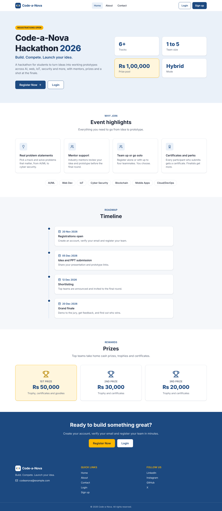
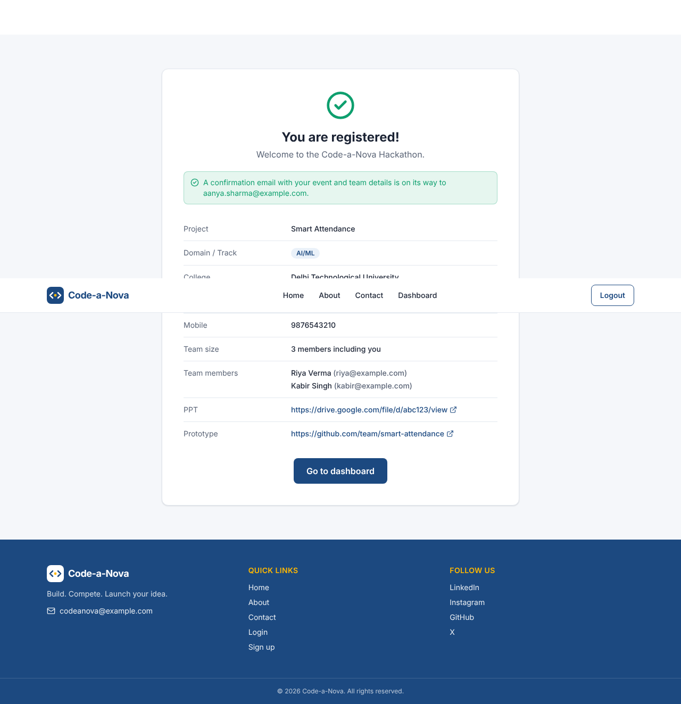

# Code-a-Nova Hackathon Registration Portal

A full-stack web app where students sign up, verify their email with a one-time code, log in, and register their project and team for the Code-a-Nova Hackathon. Built with the MERN stack, written in TypeScript end to end, and deployed on Render.

| | |
|---|---|
| **Live app** | `<paste the Render web URL after deploying>` |
| **API docs (Swagger)** | `<paste the Render API URL>/api/docs` |
| **Demo video** | `<paste link>` |

> Heads up: the API runs on Render's free plan, so the first request after a quiet period can take up to a minute while it wakes up.

## What it does

1. **Sign up** with name, email and password. The server emails a 6-digit code (valid for 10 minutes, usable once).
2. **Verify** the code on a six-box input that supports typing, pasting and autofill. A wrong code is counted; after 5 misses you must request a new one.
3. **Log in.** A JWT is issued and the private pages unlock.
4. **Dashboard** shows your profile and your registration. If you have not registered yet, there is a clear **Register Now** button.
5. **Register** your project: college, course, branch, track, project name, PPT, prototype and demo links, and your team. Pick a team size and the form shows the right number of member boxes.
6. **Confirmation email** goes out with your event and team details. Withdraw the registration or edit your name any time from the dashboard.

There is also a landing page (hero, highlights, timeline, prizes), About, Contact, a responsive navbar with a mobile menu, and a footer.

## Screenshots

| | |
|---|---|
|  |  |
|  |  |
|  |  |
|  |  |

## Tech stack, and why

| Layer | Choice | Why |
|---|---|---|
| Frontend | React 19, Vite, TypeScript, React Router | Fast dev loop, typed API calls |
| Styling | Tailwind CSS v4, hand-built components | Full control over a flat, clean look (no gradients) |
| Forms | react-hook-form + Zod | Instant feedback; server errors land under the right field |
| Backend | Node.js, Express, TypeScript | Required by the brief; small and easy to read |
| Database | MongoDB Atlas + Mongoose | Required by the brief (see "Decisions we would revisit") |
| Auth | JWT + bcrypt | Required by the brief |
| Email | Nodemailer over SMTP | Required by the brief |
| API contract | OpenAPI 3 (served as Swagger UI) | One file drives validation, docs and types |
| Tests | Jest + Supertest (API), Vitest + Testing Library (UI) | Fast, no real email or real database needed |
| Hosting | Render (Node web service + static site), no Docker | As requested |

## How it is put together

```
/server   Express API: routes -> controllers -> services -> models
/client   React app: pages, small UI kit, typed API layer
/docs     Architecture Decision Records, API and database schema, screenshots
render.yaml   Render Blueprint (API + static site)
```

A few things we cared about in this codebase:

- **One source of truth for the API.** `server/openapi/openapi.yaml` validates every request at runtime, powers Swagger UI, supplies the dropdown lists, and generates the TypeScript types used by both server and client. Zod only covers what OpenAPI cannot: environment variables, cross-field rules (password match, team member count) and the JWT payload.
- **Security basics done properly.** bcrypt (cost 12), OTPs stored as an HMAC hash with expiry, single use, attempt limit and resend cooldown, constant-time comparisons, login that does not reveal whether an email exists, rate limiting, Helmet, a CORS allow-list, `Cache-Control: no-store` on API responses, HTML-escaped email templates, and no secrets in the repo.
- **Failure-friendly UX.** If the OTP email cannot be sent, the user is still taken to the verification page with a Resend option. A failed confirmation email never undoes a saved registration.
- **Decisions are written down.** 18 short ADRs in `docs/adr/` explain what was chosen, what was rejected and why.
- **Accessible and responsive.** Labelled inputs with error messages, visible focus, skip link, semantic headings, no horizontal scroll at 390 px wide.

## Decisions we would revisit

This is the honest part. Some choices were made because the brief asked for them, not because they are what we would pick on our own.

- **MongoDB was required, but we would have chosen PostgreSQL.** The data is relational: one user has at most one registration, a registration has team members, and organisers will want to filter, count and export. PostgreSQL gives real foreign keys, `CHECK` constraints (team size 1 to 5), transactions and easy reporting with SQL. Here MongoDB works fine, and we compensated with unique indexes, schema validation in Mongoose and a documented schema, but we would reach for Postgres (with Prisma or Drizzle) first. Because the services talk to the database through small models, moving over would mostly touch `server/src/models` and the services, not the API or the UI.
- **JWT in `localStorage`.** The brief allows it, and with the site and API on different domains it is the simplest approach. An httpOnly cookie on a shared domain, with refresh tokens, is safer against XSS and is what we would ship for real users. Logout today only deletes the token; there is no server-side revocation.
- **OTP stored on the user record.** Simple and correct for this size. At scale we would use a TTL collection or Redis, and clean up accounts that never verify.
- **Gmail locally, Brevo in production.** Render's free plan blocks outbound SMTP on ports 25, 465 and 587, so Gmail cannot work there. Production uses Brevo's relay on port 2525 (still Nodemailer). A paid Render instance would let Gmail work unchanged.
- **Hand-built UI instead of Material UI.** The brief allowed either. We wanted a specific flat look and full control, at the cost of writing a few components myself.
- **Team size means "including you".** The brief was ambiguous ("size 1 is solo" and "size 3 shows 3 boxes" cannot both hold). We chose size = total people, so size 3 shows 2 member boxes. It is a one-line change if the organisers want the other reading (see ADR-0006).

## Run it locally

You need Node 20 or newer, a free [MongoDB Atlas](https://www.mongodb.com/cloud/atlas) cluster, and either a Gmail App Password or a Brevo account for email. `instructions.md` has the click-by-click setup for each.

```bash
# API (http://localhost:5000, Swagger at /api/docs)
cd server
cp .env.example .env        # fill in MONGO_URI, JWT_SECRET (32+ chars), email settings
npm install
npm run dev

# Web app (http://localhost:5173, proxies /api to the API)
cd client
cp .env.example .env
npm install
npm run dev
```

Handy scripts, in both folders: `npm test`, `npm run typecheck`, `npm run build`, and `npm run gen:types` after editing `server/openapi/openapi.yaml`.

## Testing

- **API:** 90 Jest tests (Supertest against the real Express app and an in-memory MongoDB; email is mocked). They cover the OTP rules, JWT guard, ownership checks, validation and email templates.
- **UI:** 55 Vitest tests (Testing Library) for forms, the OTP input, route guards, the dashboard and the dynamic team fields.
- **End to end:** the whole journey was also exercised in a real browser (Playwright) against the real API, a real MongoDB and a local mail catcher: signup, OTP, login, registration, confirmation email, contact form and logout, at desktop and phone widths. That script is not part of the repo yet.

## Deployment

`render.yaml` describes both services, so a Render **Blueprint** deploys everything from this repo: a Node web service for the API and a static site for the React app, with a health check and single-page-app routing. Secrets are never stored in the file; Render asks for them. Step by step, including the Brevo email setup, is in section 11 of `instructions.md`.

## More documentation

- [`instructions.md`](instructions.md): full setup guide (Atlas, email, running, deploying, troubleshooting)
- [`docs/adr/`](docs/adr/README.md): architecture decision records
- [`docs/api-schema.md`](docs/api-schema.md) and [`server/openapi/openapi.yaml`](server/openapi/openapi.yaml): API contract
- [`docs/database-schema.md`](docs/database-schema.md): collections, fields and indexes

## What we would do next

A GitHub Actions pipeline that runs both test suites on every push, the browser end-to-end script in the repo, an organiser dashboard with CSV export, httpOnly-cookie sessions, and a move to PostgreSQL.

## Contact

Questions about the hackathon: `<project email>`