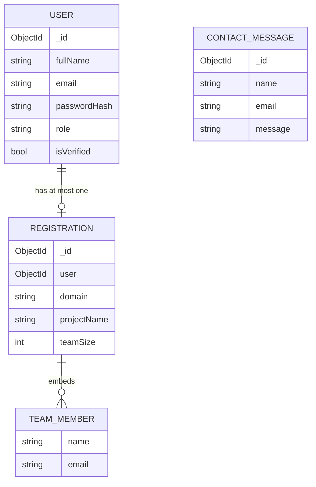

# Database Schema (MongoDB + Mongoose)

Database: `code-a-nova`. Models live in `server/src/models/`. Dropdown enums come from
`server/openapi/openapi.yaml` (ADR-0003).

## `users`
| Field | Type | Rules |
|---|---|---|
| `_id` | ObjectId | auto |
| `fullName` | String | required, trimmed |
| `email` | String | required, **unique**, lowercase, trimmed |
| `passwordHash` | String | required, bcrypt hash, `select:false` |
| `role` | String | `participant` (default) \| `admin` |
| `isVerified` | Boolean | default `false`; set true after OTP |
| `otpHash` | String | HMAC of OTP, `select:false`, removed after success |
| `otpExpiresAt` | Date | now + 10 min, `select:false` |
| `otpAttempts` | Number | default 0, max 5, `select:false` |
| `otpLastSentAt` | Date | resend cooldown, `select:false` |
| `createdAt`, `updatedAt` | Date | timestamps |

JSON output strips `passwordHash` and all `otp*` fields and maps `_id` to `id`.

## `registrations`
| Field | Type | Rules |
|---|---|---|
| `user` | ObjectId -> users | required, **unique** (one registration per user) |
| `fullName` | String | letters/spaces, 3-60 |
| `email` | String | must equal the account email |
| `mobile` | String | `^[6-9]\d{9}$` (string, not Number, to keep it exact) |
| `college` | String | enum `College` |
| `course` | String | enum `Course` |
| `branch` | String | enum `Branch` |
| `yearOfStudy` | String | enum `YearOfStudy` |
| `domain` | String | enum `Domain` |
| `projectName` | String | 5-100 chars |
| `pptLink` | String | https URL on Google Drive/Docs/OneDrive/SharePoint |
| `prototypeLink` | String | any http(s) URL |
| `demoVideoLink` | String \| null | optional; YouTube or Drive |
| `teamSize` | Number | 1-5, includes the registrant (ADR-0006) |
| `teamMembers[]` | `{ name, email }` (no `_id`) | length = `teamSize - 1`, unique emails |
| `createdAt`, `updatedAt` | Date | timestamps |

## `contactmessages`
`name` (String), `email` (String, lowercase), `message` (String), timestamps.

## Indexes
- `users.email` unique
- `registrations.user` unique

## Possible future changes
- TTL cleanup for unverified users; `registrations.domain` index if an admin dashboard is added.
